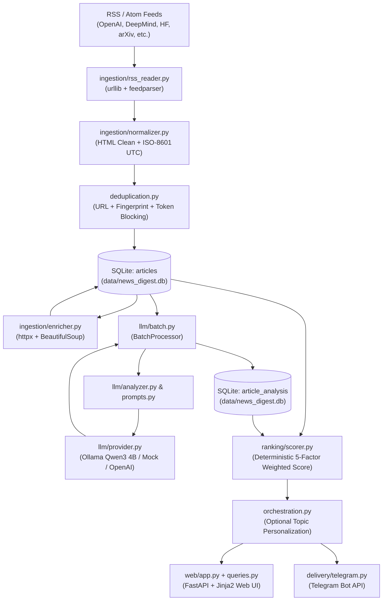
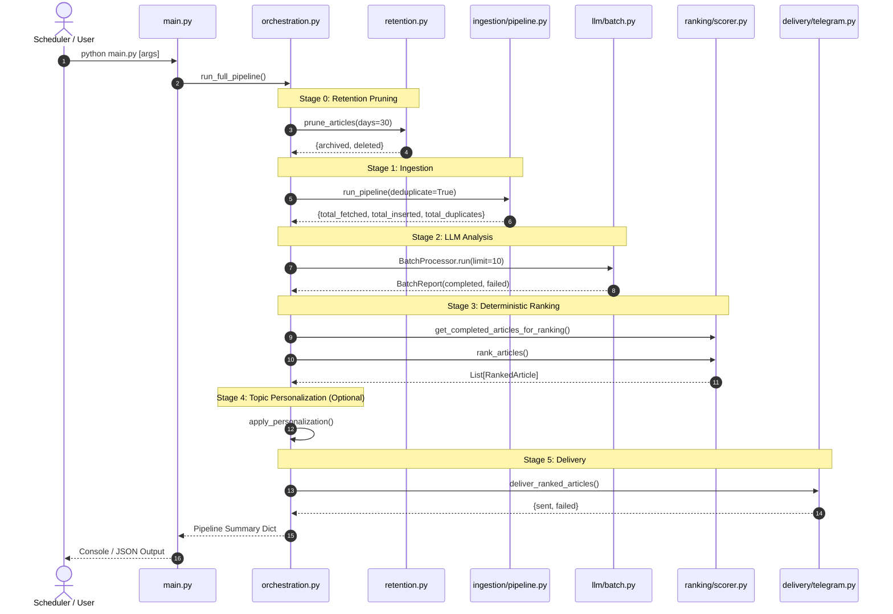
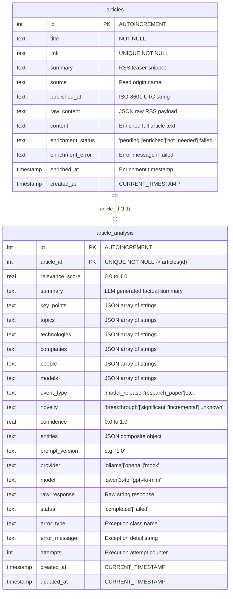
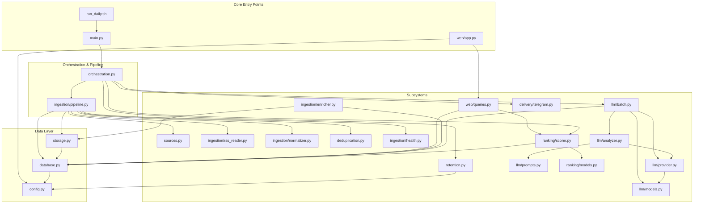

# System Architecture Documentation

**AI News Intelligence Monitor & Digest**  
*Document Version:* 1.0  
*Target Release:* Task 1.4 Baseline Audit  

---

## 1. Project Purpose & High-Level Architecture

The **AI News Digest** is an automated, self-contained intelligence monitor designed to aggregate, normalize, enrich, analyze, rank, and present artificial intelligence news and research. It bridges the gap between raw RSS/Atom feeds and actionable intelligence by combining deterministic software engineering with local Large Language Model (LLM) extraction.

### Core Objectives
1. **Multi-Source Aggregation**: Ingest feeds from leading AI research labs, industry newsrooms, and preprint servers.
2. **Progressive Deduplication**: Identify exact, normalized, content-fingerprint, and lexical duplicates across sources without data loss.
3. **Webpage Content Enrichment**: Automatically detect truncated RSS snippets and fetch substantive article text from origin URLs.
4. **Structured LLM Analysis**: Extract entities, topics, technologies, novelty, event classifications, and concise summaries using local models (e.g. Ollama with Qwen3 4B) or cloud-compatible providers.
5. **Deterministic Ranking**: Combine relevance, novelty category, recency half-life decay, and extraction confidence using deterministic mathematical scoring.
6. **Multi-Channel Presentation**: Deliver ranked intelligence via a server-rendered FastAPI web interface and automated Telegram notifications.



---

## 2. Repository Inventory & File Responsibilities

| Path | Primary Responsibility | Key Classes / Functions | Inputs | Outputs | Role | Status |
| :--- | :--- | :--- | :--- | :--- | :--- | :--- |
| `config.py` | Environment variable parsing and path resolution | `BASE_DIR`, `DATABASE_PATH`, `LLM_*`, `TELEGRAM_*` | `.env`, OS environment | Configuration constants | Configuration | Active |
| `database.py` | SQLite connection pooling and schema migrations | `get_connection()`, `init_db()` | DB file path | `sqlite3.Connection`, tables/indexes | Storage / DB | Active |
| `storage.py` | Article repository persistence and lookups | `save_article()`, `get_article_by_id()`, `update_article_enrichment()` | Article dicts, DB conn | Insertion flags, dict records | Storage / DB | Active |
| `sources.py` | Central RSS feed source configuration and validation | `DEFAULT_SOURCES`, `validate_source_config()`, `get_sources()` | Source dictionaries | Validated source list | Ingestion config | Active |
| `deduplication.py` | Multi-stage progressive deduplication and story candidate blocking | `normalize_url()`, `content_fingerprint()`, `deduplicate_articles()` | Article lists | Unique articles, cluster mapping | Pipeline logic | Active |
| `retention.py` | Rolling retention pruning and archival | `prune_articles()`, `archive_stats()` | Retention days threshold | Pruned counts, archive DB records | Maintenance | Active |
| `audit.py` | Read-only database quality inspection and reporting | `audit_database()`, `format_audit_report()` | SQLite articles table | Structured metrics dict, text report | Utility / Audit | Active |
| `orchestration.py` | Master end-to-end pipeline coordinator | `run_full_pipeline()`, `apply_personalization()` | Stage parameters, DB path | Composite run execution summary | Core Orchestrator | Active |
| `main.py` | CLI execution entry point | `main()`, `build_parser()`, `run_once()` | CLI arguments (`sys.argv`) | Exit code, console report / JSON | Application Entry | Active |
| `run_daily.sh` | Shell wrapper for automated cron/launchd execution | Shell execution | Environment, file system | Log file in `data/`, exit code | Scheduler script | Active |
| `ingestion/rss_reader.py` | HTTP network fetching and XML feed parsing | `fetch_rss_feed()`, `parse_rss_content()` | HTTP URL, XML string | List of raw entry dicts | Ingestion | Active |
| `ingestion/normalizer.py` | Normalizes heterogeneous feed data into standard article schema | `normalize_article()`, `clean_html()`, `normalize_datetime()` | Raw feed entry dict | Standardized article dict | Ingestion | Active |
| `ingestion/enricher.py` | Webpage scraper for articles with missing/insufficient text | `enrich_article()`, `fetch_webpage_content()`, `extract_article_text_from_html()` | Article ID, webpage URL | Extracted clean text, updated DB row | Ingestion | Active |
| `ingestion/health.py` | Source health evaluation and diagnostic reporting | `evaluate_source_health()`, `format_health_report()` | Feed run counters, timestamps | Diagnostic dictionary, ASCII table | Ingestion / Health | Active |
| `ingestion/pipeline.py` | Ingestion stage coordinator | `run_pipeline()`, `_collect_entries()` | Configured sources, DB conn | Ingestion summary dict | Ingestion | Active |
| `llm/models.py` | Data contracts and validation for analysis requests and results | `AnalysisRequest`, `AnalysisResult` | Parsed JSON dicts, metadata | Validated typed instances | LLM Core | Active |
| `llm/prompts.py` | Versioned system instructions and prompt templates | `SYSTEM_PROMPT`, `USER_PROMPT_TEMPLATE`, `build_analysis_prompt()` | Article metadata strings | Fully rendered prompt text | LLM Core | Active |
| `llm/provider.py` | Provider abstraction and concrete drivers (Ollama, OpenAI, Mock) | `LLMProvider`, `OllamaProvider`, `OpenAICompatibleProvider`, `MockLLMProvider`, `get_llm_provider()` | `AnalysisRequest` | Validated `AnalysisResult` | LLM Core | Active |
| `llm/analyzer.py` | Article sanitization and analysis dispatcher | `prepare_article_input()`, `analyze_article()` | Article DB record | `AnalysisRequest`, `AnalysisResult` | LLM Core | Active |
| `llm/batch.py` | Batch execution with bounded retries and crash-safe persistence | `BatchProcessor`, `save_analysis_success()`, `save_analysis_failure()`, `get_unprocessed_articles()` | Unanalyzed articles | `BatchReport`, `article_analysis` rows | LLM Core | Active |
| `llm/exceptions.py` | Typed hierarchy of transient and permanent LLM failure states | `LLMError`, `LLMTimeoutError`, `LLMSchemaValidationError`, etc. | Error messages | Exception instances | LLM Core | Active |
| `ranking/models.py` | Immutable data structures for ranking weights and component scores | `RankingWeights`, `ComponentScores`, `RankedArticle` | Float weights, component scores | Typed ranking models | Ranking Core | Active |
| `ranking/scorer.py` | Deterministic mathematical scoring and tie-breaking engine | `rank_articles()`, `score_article()`, `calculate_recency_score()` | Joined article/analysis rows | Sorted list of `RankedArticle` | Ranking Core | Active |
| `delivery/telegram.py` | Telegram Bot API delivery driver and formatting | `TelegramConfig`, `send_telegram_message()`, `deliver_ranked_articles()` | Ranked article list, Bot credentials | HTTP dispatch summary | Delivery | Active |
| `web/app.py` | FastAPI application defining routes and Jinja2 template rendering | `create_app()`, routes (`/`, `/article/{id}`, `/about`) | HTTP requests | HTML responses | Web UI | Active |
| `web/queries.py` | Strictly read-only queries formatting data for web presentation | `get_summary_stats()`, `get_ranked_articles_for_dashboard()`, `get_latest_articles()`, `score_to_stars()` | Query filters, DB conn | Formatted UI dictionaries | Web UI | Active |
| `scripts/install_cron.sh` | Installs macOS launchd plist for automated 9:00 AM daily execution | Shell execution | Plist template | Installed launch agent | Automation | Active |
| `scripts/com.ai-news-digest.daily.plist` | Launchd daemon configuration for macOS | XML configuration | System scheduler | Triggered run of `run_daily.sh` | Automation | Active |
| `demo_*.py` (7 files) | Verification and demonstration scripts from prior developmental milestones | `main()` scripts | CLI invocations | Console outputs | Demo / Utility | Maintenance |

---

## 3. Application Execution Flow & Entry Points

The system features three distinct operational entry points:
1. **Pipeline Batch CLI (`main.py`)**: Runs scheduled batch cycles.
2. **Automated Shell Driver (`run_daily.sh`)**: Triggers `main.py --output json` with file logging and exit code tracking.
3. **Web Dashboard Server (`web/app.py`)**: Hosts the user-facing presentation layer via ASGI (`uvicorn`).

### Execution Flow: Pipeline Run (`main.py`)



---

## 4. End-to-End Article Lifecycle: Concrete Trace

To illustrate the concrete interactions of every file, function, input, and output, we trace real database record **Article 2646**:

- **Article Title**: `Rakuten fixes issues twice as fast with Codex`
- **Origin Link**: `https://openai.com/index/rakuten`
- **Source**: `OpenAI News`

```mermaid
flowchart TD
    S1["1. sources.py<br/>URL: https://openai.com/news/rss.xml"] --> S2["2. ingestion/rss_reader.py<br/>fetch_rss_feed() & parse_rss_content()<br/>Output: raw entry dict with link, title, guid"]
    S2 --> S3["3. ingestion/normalizer.py<br/>normalize_article()<br/>Output: standard dict, date '2026-03-11T00:00:00Z', raw_content JSON"]
    S3 --> S4["4. deduplication.py<br/>deduplicate_articles()<br/>Output: representative index (no duplicates detected)"]
    S4 --> S5["5. storage.py<br/>save_article()<br/>Output: INSERT INTO articles (id=2646, enrichment_status='pending')"]
    S5 --> S6["6. ingestion/enricher.py<br/>enrich_article(2646)<br/>Detects summary is None -> fetch_webpage_content()<br/>Scrapes 5,868 chars of clean prose<br/>Output: UPDATE articles SET content=..., enrichment_status='enriched'"]
    S6 --> S7["7. llm/analyzer.py<br/>prepare_article_input()<br/>Detects content populated -> truncates to 4,000 chars<br/>Output: AnalysisRequest(title, source, summary=content)"]
    S7 --> S8["8. llm/prompts.py<br/>build_analysis_prompt()<br/>Output: Formatted user prompt adhering to expected JSON schema"]
    S8 --> S9["9. llm/provider.py<br/>OllamaProvider.analyze()<br/>HTTP POST to http://localhost:11434/api/chat<br/>model='qwen3:4b', format='json', think=False<br/>Output: Validated JSON string"]
    S9 --> S10["10. llm/models.py<br/>AnalysisResult.from_dict()<br/>Validates relevance_score=0.95, novelty='significant', event_type='tool_release'"]
    S10 --> S11["11. llm/batch.py<br/>save_analysis_success()<br/>Output: INSERT INTO article_analysis (article_id=2646, status='completed')"]
    S11 --> S12["12. ranking/scorer.py<br/>score_article() & rank_articles()<br/>Relevance (0.95*0.40) + Novelty (0.70*0.25) + Recency Decay + Confidence (0.95*0.15)<br/>Output: RankedArticle(final_score=0.7025)"]
    S12 --> S13["13. web/queries.py & app.py<br/>score_to_stars() -> ★★★★☆<br/>clean_human_summary() -> Strips boilerplate<br/>Renders in web/templates/index.html & article.html"]
```

- **Initial State in RSS**: Contained publication date and link, but `<description>` was empty (`None`).



### Step-by-Step Function Inventory for Article 2646

1. **Feed Retrieval**: `ingestion/rss_reader.py::fetch_rss_feed` requests `https://openai.com/news/rss.xml` via `urllib.request`. Returns list of raw entry dicts.
2. **Normalization**: `ingestion/normalizer.py::normalize_article` normalizes title, cleans empty HTML description, parses publication date to ISO-8601 UTC (`2026-03-11T00:00:00Z`), and serializes raw feed entry metadata into `raw_content`.
3. **Deduplication Check**: `deduplication.py::deduplicate_articles` extracts tokens, normalizes URL, checks SHA-256 fingerprint, and confirms the article is unique.
4. **Initial Storage**: `storage.py::save_article` executes `INSERT OR IGNORE INTO articles`. Database assigns `id = 2646` with default `enrichment_status = 'pending'`.
5. **Content Enrichment**: `ingestion/enricher.py::enrich_article(2646)` identifies that `summary` is `None` (insufficient content). Invokes `fetch_webpage_content('https://openai.com/index/rakuten')` using `httpx`. `BeautifulSoup` decomposes nav/footer/script elements and extracts 5,868 characters of substantive text. Calls `storage.py::update_article_enrichment` to save text in `content` and mark `enrichment_status = 'enriched'`.
6. **Input Preparation**: `llm/analyzer.py::prepare_article_input` detects `content` is present, truncates to 4,000 characters, and produces typed `AnalysisRequest`.
7. **Prompt Construction**: `llm/prompts.py::build_analysis_prompt` interpolates metadata and article text into `USER_PROMPT_TEMPLATE`.
8. **Inference Execution**: `llm/provider.py::OllamaProvider.analyze` posts HTTP payload to local Ollama daemon (`http://localhost:11434/api/chat`) running `qwen3:4b` with `"think": False` and `"format": "json"`.
9. **Schema Validation**: `llm/models.py::AnalysisResult.from_dict` parses response JSON, validates field types, clamps relevance score (`0.95`) and confidence (`0.95`), and validates categories (`event_type="tool_release"`, `novelty="significant"`).
10. **Persistence**: `llm/batch.py::save_analysis_success` performs an atomic upsert into `article_analysis` with `status = 'completed'` and `attempts = 1`.
11. **Deterministic Ranking**: `ranking/scorer.py::rank_articles` evaluates the article:
    $$\text{Final Score} = (0.40 \times 0.95) + (0.25 \times 0.70) + (0.20 \times \text{Recency}) + (0.15 \times 0.95) = 0.7025$$
12. **Presentation**: `web/queries.py::get_ranked_articles_for_dashboard` formats score into 4 stars (`★★★★☆`), strips internal machine confidence metrics, cleans summary text, and sends to `web/templates/index.html`.

---

## 5. Database Architecture & Schema

The application uses an embedded **SQLite** database (`data/news_digest.db`) with `PRAGMA foreign_keys = ON` and explicit column indices.



### Database Responsibilities & Write Ownership

| Operation | Function | Owning File | Guarantees |
| :--- | :--- | :--- | :--- |
| Schema Init & Migrations | `init_db()` | `database.py` | Idempotent table and index creation, automatic column migrations. |
| Ingestion Article Insert | `save_article()` | `storage.py` | `INSERT OR IGNORE` on `UNIQUE(link)`. Prevents duplicate URLs. |
| Enrichment Update | `update_article_enrichment()` | `storage.py` | Atomic field update for `content`, `enrichment_status`, `enriched_at`. |
| Analysis Success Upsert | `save_analysis_success()` | `llm/batch.py` | `ON CONFLICT(article_id) DO UPDATE` ensures idempotency on retries. |
| Analysis Failure Upsert | `save_analysis_failure()` | `llm/batch.py` | Persists failure status and error details without dropping row. |
| Retention Pruning | `prune_articles()` | `retention.py` | Moves expired records to `news_digest_archive.db`; cascades cleanup. |
| Web Queries | `get_*` | `web/queries.py` | **100% Read-Only**. Zero SQL `INSERT`, `UPDATE`, or `DELETE`. |

---

## 6. Ingestion & Content Enrichment Architecture

### RSS Ingestion Pipeline
1. **Source Configuration (`sources.py`)**: Defines validated feeds with target URLs and types (`rss` or `atom`).
2. **Feed Fetching (`ingestion/rss_reader.py`)**: Uses standard library `urllib.request` with custom `User-Agent: AI-News-Digest/1.0` and bounded 10-second timeout.
3. **Normalization (`ingestion/normalizer.py`)**:
   - `clean_html()` uses a custom `HTMLParser` to preserve block-level spacing while stripping markup.
   - `normalize_datetime()` attempts ISO-8601 parsing, falls back to RFC 822/2822, and normalizes to UTC `YYYY-MM-DDTHH:MM:SSZ`.
4. **Progressive Deduplication (`deduplication.py`)**:
   - **Stage 1**: Exact link match.
   - **Stage 2**: URL normalization (stripping tracking query params like `utm_*`, port defaults, trailing slashes).
   - **Stage 3**: Content fingerprinting (SHA-256 over normalized title and summary).
   - **Stage 4**: Exact normalized title comparison.
   - **Stage 5**: Inverted-index token blocking + `difflib.SequenceMatcher` ratio ($\ge 0.85$) and token Jaccard similarity ($\ge 0.65$).
5. **Source Health (`ingestion/health.py`)**: Evaluates feed performance (`HEALTHY`, `WARNING`, `FAILED`), detecting empty feeds, high invalid ratios, and stale feeds (> 90 days).

### Webpage Content Enrichment (`ingestion/enricher.py`)
Many AI feeds (e.g. OpenAI, Hugging Face, MIT Tech Review) provide only a brief headline or truncated metadata in their RSS XML.

```
       +------------------------------------+
       | Article Record from RSS Ingestion  |
       +------------------------------------+
                         |
             is_usable_content(summary)?
            /                           \
         [YES]                         [NO]
          /                               \
Mark 'not_needed'                   Fetch article 'link' via HTTP
(Skip web fetch)                    (httpx, follow_redirects=True)
                                          |
                                    HTTP 200 OK?
                                   /            \
                                [YES]           [NO]
                                 /                \
                       BeautifulSoup parse     Mark 'failed'
                       Decompose boilerplate   Record error
                       Extract article prose        |
                                 |             Store in DB
                       is_usable_content()?
                      /                    \
                   [YES]                   [NO]
                    /                        \
          Mark 'enriched'               Mark 'failed'
          Save to 'content'             Record error
```

#### Distinction: `raw_content` vs `summary` vs `content`
- **`raw_content`**: A JSON string containing the exact raw dictionary emitted by `feedparser` together with source configuration metadata. Preserved for debugging, regression testing, and data provenance.
- **`summary`**: The short teaser string extracted from the RSS feed's `<description>` or `<summary>` tag. Often truncated, missing, or containing marketing boilerplate.
- **`content`**: The full, readable article body text extracted from the original webpage URL via the enrichment layer (`ingestion/enricher.py`). Used as the primary input for LLM analysis.

---

## 7. LLM Analysis Architecture

The LLM subsystem transforms unstructured article text into strongly validated, structured intelligence facts.

```
+---------------------------------------------------------------------------------+
|                                 LLM SUBSYSTEM                                   |
|                                                                                 |
|  +---------------------+        +--------------------+                          |
|  |  Database Article   | -----> | prepare_article_   |                          |
|  | (content / summary) |        |       input()      |                          |
|  +---------------------+        +--------------------+                          |
|                                           |                                     |
|                                           v                                     |
|                                 +--------------------+                          |
|                                 |  AnalysisRequest   |                          |
|                                 +--------------------+                          |
|                                           |                                     |
|                                           v                                     |
|                                 +--------------------+                          |
|                                 | build_analysis_    |                          |
|                                 |      prompt()      |                          |
|                                 +--------------------+                          |
|                                           |                                     |
|                                           v                                     |
|                                 +--------------------+                          |
|                                 |    LLMProvider     |                          |
|                                 |    Abstraction     |                          |
|                                 +--------------------+                          |
|                                   /       |        \                            |
|                                  /        |         \                           |
|                                 v         v          v                          |
|                          +--------+  +---------+  +---------+                   |
|                          |  Mock  |  | OpenAI  |  | Ollama  |                   |
|                          | Driver |  | Driver  |  | Driver  |                   |
|                          +--------+  +---------+  +---------+                   |
|                                                        |                        |
|                                                        v                        |
|                                               Ollama HTTP Daemon                |
|                                              POST /api/chat                     |
|                                              model: qwen3:4b                    |
|                                              format: json                       |
|                                              think: false                       |
|                                                        |                        |
|                                                        v                        |
|                                               Raw JSON Response                 |
|                                                        |                        |
|                                                        v                        |
|                                               +--------------------+            |
|                                               |   AnalysisResult   |            |
|                                               |    (Validation)    |            |
|                                               +--------------------+            |
|                                                        |                        |
|                                                        v                        |
|                                               +--------------------+            |
|                                               |  article_analysis  |            |
|                                               |   (Persistence)    |            |
|                                               +--------------------+            |
+---------------------------------------------------------------------------------+
```

### Provider Driver Details

1. **`OllamaProvider` (`llm/provider.py`)**:
   - Communicates with local Ollama daemon at `http://localhost:11434/api/chat`.
   - Forces structured JSON output via `"format": "json"`.
   - Explicitly passes `"think": False` to disable internal chain-of-thought traces, reducing latency from > 120s to **6.8s–9.8s** per article.
   - Cleans lingering `<think>...</think>` regex patterns defensively.
2. **`OpenAICompatibleProvider` (`llm/provider.py`)**:
   - Supports OpenAI, OpenRouter, and compatible REST gateways using standard library `urllib.request`.
   - Uses `response_format: {"type": "json_object"}`.
   - Masks all API credentials in exceptions and logs.
3. **`MockLLMProvider` (`llm/provider.py`)**:
   - Completely offline, deterministic fallback for unit tests and local development without GPU or daemon dependencies.

### Resumability & Bounded Retries (`llm/batch.py`)
- Unprocessed articles are queried via `LEFT JOIN article_analysis WHERE an.id IS NULL OR an.status != 'completed' ORDER BY a.id ASC`.
- Transient errors (`LLMTimeoutError`, `LLMProviderUnavailableError`, `LLMRateLimitError`) trigger exponential retries up to `max_retries` (default 2).
- Non-transient errors (`LLMMalformedResponseError`, `LLMSchemaValidationError`) fail immediately without consuming retries.
- Every outcome (success or failure) is persisted atomically to `article_analysis`, ensuring safe resumability after any crash.

---

## 8. Deterministic Ranking Architecture

Unlike black-box LLM ranking, the AI News Digest employs a **deterministic 5-component scoring model** (`ranking/scorer.py`).

$$\text{Final Score} = w_r \cdot S_{\text{relevance}} + w_n \cdot S_{\text{novelty}} + w_t \cdot S_{\text{recency}} + w_c \cdot S_{\text{confidence}} + w_e \cdot S_{\text{event\_type}}$$

### Default Component Weights (`ranking/models.py`)
- **$w_r$ (Relevance)**: `0.40`
- **$w_n$ (Novelty)**: `0.25`
- **$w_t$ (Recency)**: `0.20`
- **$w_c$ (Confidence)**: `0.15`
- **$w_e$ (Event Type)**: `0.00` (reserved for custom domain tuning)
- $\sum w_i = 1.00$

### Component Scoring Rules

1. **Relevance Score ($S_{\text{relevance}}$)**: Bounded float in $[0.0, 1.0]$ extracted by the LLM indicating topical relevance to Artificial Intelligence.
2. **Novelty Score ($S_{\text{novelty}}$)**: Mapped from structured LLM categorical output:
   - `breakthrough`: `1.0`
   - `significant`: `0.7`
   - `incremental`: `0.4`
   - `unknown`: `0.1`
3. **Recency Half-Life Decay ($S_{\text{recency}}$)**:
   $$S_{\text{recency}} = 2^{-\frac{\Delta \text{days}}{\lambda}}$$
   where $\lambda = 7.0\text{ days}$ (default half-life). An article published today scores `1.0`; an article 7 days old scores `0.5`; 14 days old scores `0.25`. Missing or invalid dates fall back to a safe floor of `0.20`.
4. **Confidence Score ($S_{\text{confidence}}$)**: Bounded float in $[0.0, 1.0]$ indicating extraction confidence.
5. **Deterministic Tie-Breaking**:
   Sort key: `(-round(final_score, 6), -published_at_epoch, article_id_asc)`.

> [!IMPORTANT]
> **LLM Relevance vs. Deterministic Ranking**  
> The LLM's `relevance_score` is only an *input* to the ranking system ($40\%$ weight). The final ranking is calculated deterministically by combining recency, novelty, and confidence. An LLM prompt never directly decides which article is ranked #1.

---

## 9. Web Presentation & Delivery Architecture

### Web Application (`web/app.py` & `web/queries.py`)
- Built on **FastAPI** + **Jinja2** server-rendered HTML. No client-side framework (React/Vite) overhead.
- **Strictly Read-Only**: `web/queries.py` issues only `SELECT` queries with parameterized inputs.
- **Human-Centric Presentation**:
  - Scores are translated into 5-star indicators (`score_to_stars`):
    - $0.80 - 1.00 \to \bigstar\bigstar\bigstar\bigstar\bigstar$
    - $0.60 - 0.79 \to \bigstar\bigstar\bigstar\bigstar\star$
    - $0.40 - 0.59 \to \bigstar\bigstar\bigstar\star\star$
    - $0.20 - 0.39 \to \bigstar\bigstar\star\star\star$
    - $0.00 - 0.19 \to \bigstar\star\star\star\star$
  - Machine confidence decimals and LLM boilerplate phrases are stripped from public cards.
- **Routes**:
  - `GET /`: Dashboard with "Hot Topics" (top-ranked), "All Ingested News" (paginated), summary stats cards, and source/event-type filters.
  - `GET /article/{article_id}`: Full article detail view showing extracted summary, key takeaways, entities, and origin link.
  - `GET /about`: Architecture overview and system statistics.

### Telegram Delivery Channel (`delivery/telegram.py`)
- Sends compact Markdown digests of top-ranked stories via the Telegram Bot API (`/sendMessage`).
- Configurable minimum score cutoff (`TELEGRAM_MIN_SCORE`) and article limits (`TELEGRAM_LIMIT`).
- Integrated into `orchestration.py` (Stage 5), controlled by `TELEGRAM_ENABLED` in `.env`.

---

## 10. Testing Architecture

The project maintains an automated test suite comprising **174 unit and integration tests** executing in **< 0.6 seconds** via `pytest`.

```
======================== 174 passed in 0.51s ========================
```

| Subsystem | Test File | Test Count | Key Behaviors Protected |
| :--- | :--- | :---: | :--- |
| **Database** | `tests/test_database.py` | 1 | Connection generation, schema creation, column migrations. |
| **Storage** | `tests/test_storage.py` | 5 | Article insertion, duplicate link prevention, enrichment updates. |
| **Sources** | `tests/test_sources.py` | 7 | Required keys, URL format validation, enabled filter logic. |
| **RSS Reader** | `tests/test_rss_reader.py` | 5 | XML parsing, Bozo exceptions, HTTP errors, timeouts. |
| **Normalization** | `tests/test_normalization.py` | 11 | HTML stripping, whitespace collapsing, ISO-8601 UTC date parsing. |
| **Deduplication** | `tests/test_deduplication.py` | 12 | URL query parameter stripping, fingerprinting, token blocking, cluster union. |
| **Enrichment** | `tests/test_enrichment.py` | 14 | Usability heuristics, HTML article container extraction, HTTP error handling, idempotency. |
| **LLM Engine** | `tests/test_llm.py` | 29 | Schemas, prompt rendering, Ollama/OpenAI/Mock providers, `think=False`, JSON enforcement. |
| **Batch Analysis**| `tests/test_batch_analysis.py` | 14 | Unprocessed selection, bounded transient retries, failure persistence, resumability. |
| **Ranking** | `tests/test_ranking.py` | 12 | Weights summing to 1.0, novelty/event mappings, half-life decay, tie-breaking. |
| **Orchestration** | `tests/test_orchestration.py` | 13 | Full pipeline chaining, stage integration, topic weighting personalization. |
| **Web UI** | `tests/test_web.py` | 15 | FastAPI routes, Jinja2 filters, star mappings, pagination, 404 handlers. |
| **Delivery** | `tests/test_delivery.py` | 13 | Telegram config validation, message formatting, HTTP mocking, disabled skip. |
| **Retention** | `tests/test_retention.py` | 8 | Pruning cutoff calculation, archive DB copying, cascading delete. |
| **Audit** | `tests/test_audit.py` | 6 | Read-only database quality inspection, anomaly detection, report formatting. |

---

## 11. Component Dependency Map



---

## 12. Current Architectural Observations & Proposed Structure

### Observations
1. **Root Directory Clutter**: Seven demo scripts (`demo_*.py`) reside in the root directory. They were useful during incremental milestones but should eventually reside in a dedicated `examples/` or `demos/` directory.
2. **Scattered Database Write Logic**: Database write operations are spread across `storage.py` (articles), `llm/batch.py` (analyses), and `retention.py` (archival).
3. **Personalization in Orchestration**: `apply_personalization()` is housed in `orchestration.py` rather than inside the `ranking/` package.
4. **Overall Health**: The architecture is highly functional, cleanly tested, and uses no bloated frameworks. Breaking it into separate microservices or frontend apps would be counterproductive.

### Proposed Target Hierarchy (For Future Refactoring Consideration Only)
*Note: As per project constraints, no files have been moved or restructured.*

```
ai_news_digest/
├── config.py                      # Global configuration & environment loading
├── database.py                    # SQLite connection & migrations
├── main.py                        # Primary CLI entry point
├── run_daily.sh                   # Automation runner script
├── orchestration.py               # Master pipeline coordinator
│
├── storage/                       # Consolidated database repository layer
│   ├── __init__.py
│   ├── articles.py                # Article persistence & retrieval
│   ├── analysis.py                # Analysis persistence & retrieval
│   └── retention.py               # Archival & pruning logic
│
├── ingestion/                     # Ingestion & content enrichment
│   ├── __init__.py
│   ├── sources.py                 # Source feed definitions & validation
│   ├── rss_reader.py              # Feed fetcher & XML parser
│   ├── normalizer.py              # HTML cleaning & date normalization
│   ├── deduplication.py           # Multi-stage progressive deduplication
│   ├── enricher.py                # Webpage content scraper
│   ├── health.py                  # Source health diagnostics
│   └── pipeline.py                # Ingestion stage coordinator
│
├── llm/                           # Structured LLM analysis subsystem
│   ├── __init__.py
│   ├── models.py                  # Typed data models & validation
│   ├── prompts.py                 # Prompt templates & versioning
│   ├── provider.py                # Drivers (Ollama, OpenAI, Mock)
│   ├── analyzer.py                # Article sanitization & dispatch
│   ├── batch.py                   # Batch processor & retry logic
│   └── exceptions.py              # Exception definitions
│
├── ranking/                       # Deterministic scoring subsystem
│   ├── __init__.py
│   ├── models.py                  # Weight & score data structures
│   ├── scorer.py                  # 5-factor mathematical scoring
│   └── personalization.py         # Topic-weight nudging logic
│
├── delivery/                      # Output delivery channels
│   ├── __init__.py
│   └── telegram.py                # Telegram Bot API driver
│
├── web/                           # FastAPI presentation layer
│   ├── __init__.py
│   ├── app.py                     # FastAPI application & routes
│   ├── queries.py                 # Read-only formatting queries
│   ├── static/                    # CSS stylesheets & assets
│   └── templates/                 # Jinja2 HTML templates
│
├── docs/                          # Architecture & developer guides
│   ├── architecture.md
│   └── developer_guide.md
│
├── tests/                         # Automated unit & integration tests
│   └── test_*.py
│
└── demos/                         # Standalone demonstration scripts
    └── demo_*.py
```
